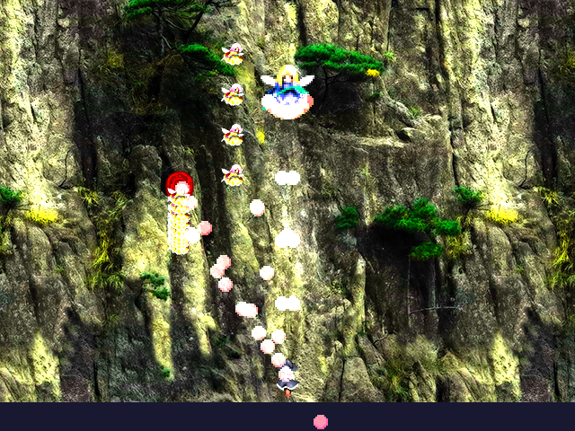
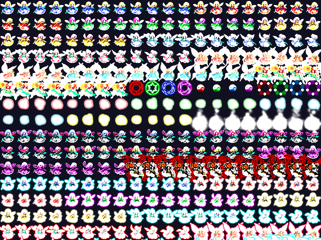
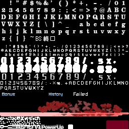

# th185

[](https://qm.qq.com/q/eeUrxIltug?from=tim)

A high-fidelity, portable reimplementation of 東方虹龍洞 外伝 ～ バレットフィリア達の闇市場 ～ 100th Black Market. ver 1.00a.

> **状态：可运行原型。**
> 加密归档 → ECL 脚本 → ANM 动画 → 软件光栅化 → 浏览器画面的整条链路已打通并验证。
> 游戏本体（波次编队、敌方弹幕、计分、菜单）尚未完成。

---

## 现在能做什么

```powershell
# 构建
node th185_web/scripts/build-cpp.mjs --app

# 启动网页外壳（需要自备 th185.dat）
node th185_web/scripts/serve-shell.mjs --port 8170 --data 'C:\path\to\th185.dat'
# 浏览器打开 http://127.0.0.1:8170/
```

**浏览器实测**：60 FPS · 32 精灵 · 32 动画 · canvas 640×480。
画面里是 TH185 的敌人精灵，各自播放自己的 ANM 动画；玩家可以移动、射击、击毁敌人、被敌人击毁。



### 从加密归档还原出的素材

下面两张图直接从 `th185.dat` 解码得到，不经过任何中间格式：

| 内容 | 说明 |
|---|---|
| `enemy.anm` 的 320 个 sprite | 证明 sprite UV 子矩形查表正确 |
| `ascii.anm` 的 256×256 图集 | 证明 THTX 像素解码正确（可读出 ASCII 字符与 `Bonus`/`History`/`Failed`/`PowerUp`） |





---

## 概要

本仓库是 [Eagler Touhou](https://github.com/YomotsuHisami/eagler-touhou)（[touhou.vip](https://touhou.vip/)）计划的 TH185 接入分支，沿用 TH08 / TH10 / TH11 已确立的 **C++ / SDL3 → WebAssembly → WebGL2** 路线。

与 TH06/TH07/TH08 的字节级 matching decomp 不同，本项目采用**功能还原重建（source reconstruction）**：

- 目标不是产出与原版逐字节相同的 `th185.exe`，而是**行为等价**——同样的输入产生同样的帧状态。
- 以原版机器码、资源结构、函数调用次序、x87/SSE 舍入行为为**行为依据**，恢复具名 C++ 管理器与脚本解释器。
- 生产运行时不执行原版 EXE，也不包含 x86 转译或 D3D9 设备适配层。

### 为什么选功能还原而非字节级 matching

TH185 使用的 MSVC 工具集是 **VS2019 16.11 区间**（Rich Header 显示 build 27412 / 31328 / 31332 三档并存），现代编译器优化远比 TH06（MSVC 2002）激进。字节级 matching 在这种工具链上投入产出比极低，而 Eagler Touhou 的产品目标是「能在浏览器里玩到原版体验」，行为等价即可满足。

---

## 四事实分离

本仓库严格遵守一条纪律：**「有源码」「能编译」「行为一致」「已验证」是四个独立事实**，不得互相替代。

| 证据等级 | 含义 |
|---|---|
| `observed` | 从原版数据/内存/机器码直接观测 |
| `corroborated` | 有外部权威定义支撑（如 thtk） |
| `behavioral` | 真实运行行为（浏览器实测、探针） |
| `inferred` | 推断，未经证实 |
| `source-present` | 有代码，未验证 |

账本（`th185_web/config/*.csv`）里每条断言都标注等级，`verified` 必须同时有 `test_ref`。

---

## 目标版本

| 项 | 值 |
|---|---|
| 作品 | 東方虹龍洞 外伝 ～ バレットフィリア達の闇市場 ～ 100th Black Market. |
| 版本 | **1.00a**（2022-08-14，唯一正式版） |
| 语言 | 日文原版 |
| `th185.exe` SHA-256 | `76bbf844e962c16004b64f1b2ef3551593056baa43ea53b9a5df45ad731345c7` |
| `th185.exe` 大小 | 883,200 字节 (0xD7A00) |
| PE TimeDateStamp | 1659144319 (0x62E4887F, 2022-07-30 01:25:19 UTC) |
| ImageBase | 0x00400000 |
| `th185.dat` SHA-256 | `5AF133F02ADD57F27FBEBA1B8D1E7D579F484B40C2595D57D4536537806D7428` |
| `thbgm.dat` SHA-256 | `5224F1311D4FD91325BCC53399DBBEFA3A6D33F14D8E820459753123D036F1EE` |

完整指纹见 [`th185_web/target.json`](th185_web/target.json)。

> 该 SHA-256 与 thcrap-tsa `versions.js` 中标注 **`(original, DLsite release)`** 的条目一致。Steam 渠道（AppID **2097720**）套了 SteamStub 壳，磁盘上的 exe 哈希不同，需脱壳后才与本仓库基准一致。

---

## 仓库结构

```
th185_web/
  cpp/game/      C++ 游戏逻辑（52 个文件，8614 行）
  cpp/sdl/       SDL 宿主与 WASM 导出层
  sdl-runtime/   网页外壳（HTML / CSS / shell.mjs）
  scripts/       构建、CI、导出、服务脚本
    native/      32 个 Python 逆向与校验工具
  config/        账本（subsystems / behaviors / symbols CSV）
  docs/          24 篇技术文档
  reference/     外部权威定义（thtk）
  tests/         测试
  artifacts/     构建产物（不入库）
```

---

## 进度

| 系统 | 状态 | 证据 |
|---|---|---|
| 目标指纹与版本考证 | ✅ 完成 | `target.json` |
| **PBG4 归档解密** | ✅ **complete** | 条目表 0 差异，284 条目全解 |
| **LZSS 解压** | ✅ **complete** | 7172→7165 字节精确 |
| **RNG** | ✅ **complete** | 逐位一致 |
| **ANM 容器** | ✅ **complete** | 55/55 文件、1879 sprite、430 纹理块 |
| ANM 纹理解码 | ✅ 完成 | 4784 万像素、0 拒绝、可读图集 |
| **ANM 解释器** | ✅ 完成 | 2121 脚本、368024 指令、`unsupported=0`、`fault=0` |
| ANM 对象调度 | ✅ 完成 | 2291 spawn、2094 回收、深度/容量上限 0 |
| **软件光栅化 + PNG** | ✅ 完成 | 10 种 blend、可辨认精灵图 |
| **应用模块 + 网页外壳** | ✅ 完成 | 浏览器实测 60 FPS |
| **玩家实体** | ✅ 完成 | 八方向/低速/边界/射击 |
| **弹幕系统** | ✅ 完成 | 固定池 4096、出界回收 |
| **碰撞判定** | ✅ 完成 | 圆形判定、16 敌人全灭 |
| **ECL 解释器** | ✅ 完成 | `first_unsupported=0` |
| **ECL 驱动敌人生成** | ✅ 完成 | `op1013` 时间表、`sched=5 fired=9` |
| 波次随机系统（110 模板 × 50 槽位） | ⬜ 待办 | 算法已解，未接入 |
| 卡牌（87 张）/ 黑市 / 双货币 | ⬜ 待办 | 表已解，未接入 |
| 8 档难度数值表 | ⬜ 待办 | 表已解，未接入 |
| 敌方弹幕图案 | ⬜ 待办 | 敌人只会单发瞄准 |
| 计分 / 擦弹 / 掉落物 | ⬜ 待办 | — |
| 菜单、对话、结局 | ⬜ 待办 | — |
| 存档 `scoreth185.dat` | ⚠️ 部分 | 格式已解，未接入 |
| 音频 | ⬜ 待办 | — |
| 启动器接入（eagler-touhou/1） | ⬜ 待办 | — |

账本实时数据：**32 个子系统 · 286 条行为断言 · 23 个已知符号**。

---

## 三个必须先知道的事实

**① 这是全球首例。** GitHub 全站搜索（`th185` / `"100th Black Market"` / `touhou 18.5` / `th185 in:readme`）只找到 Mod、随机化工具和资源编译器，**没有任何 TH185 的重建或反编译项目**。Eagler Touhou 进度表里 th185 标为 `Unassigned`。

**② Replay 被取消了——但这不是 bug，是小数点作的传统。** 扫描本机全部小数点作 exe：th095/th125/th128/th143/th165/th185 **全都没有 `Replay` UI 字符串**，只有 th18 有。所以「ZUN 代码没写好」的说法不成立；更可能是 TH185 的随机性玩法与 Replay 天然不兼容（黑市是关卡中途交互，传统 `.rpy` 表达不了）。这意味着 **TH11 那套「原版录像逐帧比对」不可直接用**，验证改用「状态快照比对 + Force Wave 确定性注入」。**不建议自建 Replay**——那是替 ZUN 解决他主动绕开的问题。详见 [docs/RECONSTRUCTION.md](th185_web/docs/RECONSTRUCTION.md) §3.2.1 与 §3.3。

**③ 规模约为 TH11 的 3~3.5 倍。** 9 场景 × 50 波次槽位、110 条波次模板池、28 个 BOSS 编号、87 个卡牌类、8 档难度。自机砍到 1 人（仅魔理沙）是唯一减项。

---

## 文档

| 文档 | 内容 |
|---|---|
| [PBG4.md](th185_web/docs/PBG4.md) | 归档加密与 LZSS（49 KB） |
| [ECL.md](th185_web/docs/ECL.md) | ECL 脚本格式与解释器（§1–§29） |
| [ECL_DRIVEN.md](th185_web/docs/ECL_DRIVEN.md) | ECL 驱动敌人生成 |
| [ECL_COROUTINE.md](th185_web/docs/ECL_COROUTINE.md) | 协程语义 |
| [ECL_STACK.md](th185_web/docs/ECL_STACK.md) | 协程的栈语义 |
| [ANM.md](th185_web/docs/ANM.md) | ANM 容器 / 纹理 / 脚本 / 调度（§1–§31） |
| [RENDER.md](th185_web/docs/RENDER.md) | 渲染层与光栅化 |
| [BANKS.md](th185_web/docs/BANKS.md) | 动画库分层 |
| [WEB.md](th185_web/docs/WEB.md) | 网页外壳 |
| [PLAYER.md](th185_web/docs/PLAYER.md) | 玩家实体 |
| [BULLETS.md](th185_web/docs/BULLETS.md) | 弹幕系统 |
| [COLLISION.md](th185_web/docs/COLLISION.md) | 碰撞判定 |
| [WAVES.md](th185_web/docs/WAVES.md) | 波次随机系统 |
| [CARDS.md](th185_web/docs/CARDS.md) / [CARD_CLASSES.md](th185_web/docs/CARD_CLASSES.md) | 卡牌表与类 |
| [DIFFICULTY.md](th185_web/docs/DIFFICULTY.md) | 8 档难度 |
| [SAVE.md](th185_web/docs/SAVE.md) | 存档格式 |
| [STAGE.md](th185_web/docs/STAGE.md) | `.std` 场景格式 |
| [RNG.md](th185_web/docs/RNG.md) | 随机数 |
| [CPP.md](th185_web/docs/CPP.md) | C++ 实现进度 |
| [BUILD.md](th185_web/docs/BUILD.md) | 构建与校验 |
| [WORKFLOW.md](th185_web/docs/WORKFLOW.md) | 工作流 |
| [PROGRESS.md](th185_web/docs/PROGRESS.md) | 进度总览 |
| [RECONSTRUCTION.md](th185_web/docs/RECONSTRUCTION.md) | 重建方法论 |

---

## 验证

```powershell
node th185_web/scripts/ci.mjs        # 全部 36 项检查
```

CI 覆盖：目标指纹、账本一致性、进度、Unicorn 探针、RNG、波次、卡牌、LZSS、难度、PBG4、存档、ANM、纹理、STD、ECL、ECL 覆盖率、ECL 解释器、栈推断，以及 12 项 **C++ 与参考实现的交叉校验**，最后是构建、真实数据运行、应用模块渲染、玩家输入、外壳契约。

---

## 构建

源码树沿用 TH08 / TH10 / TH11 的共享工作区/工具链布局。构建、校验与打包命令见 [`th185_web/docs/BUILD.md`](th185_web/docs/BUILD.md)。

构建产物写入 `th185_web/artifacts/`，不入库。

---

## Assets and licensing

This repository does not include the original Touhou executable, game data, music, replay, save files, or private development reference material. A runnable package must be assembled locally from files you are legally allowed to use.

Licensing is component-specific. Keep the notices and licenses beside each bundled component; no blanket license is asserted for the original game or its assets.
