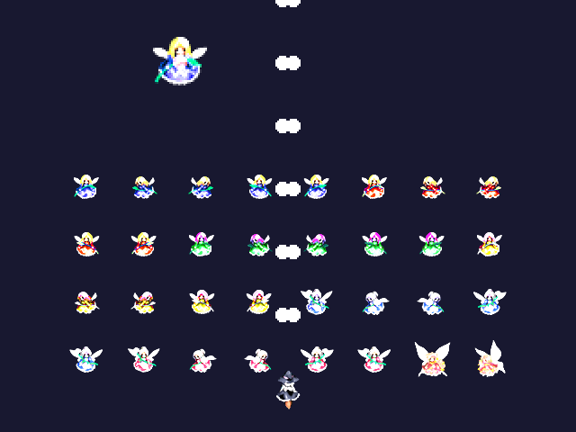

# TH185 碰撞判定

> 状态：**子弹能击中敌人，敌人会死**
> 限制：**玩家不会被击中**——没有敌方弹幕，也没有玩家判定点

---

## 1. 范围

| 做了 | 没做 |
|---|---|
| 敌人固定池（256） | 敌人由 ECL 驱动 |
| 圆形判定 | 真实弹幕图案 |
| 子弹 × 敌人碰撞 | 玩家被弹判定 |
| HP 与死亡 | 擦弹 / 得分 |
| 命中消耗子弹 | 掉落物 |

---

## 2. ★ 为什么用圆形判定

矩形判定在旋转后需要重建包围盒。
**圆形与旋转无关**，所以旋转的敌人不需要每帧重算判定形状。

```cpp
const float dx = bullet.x - enemy.x;
const float dy = bullet.y - enemy.y;
// 比较平方距离：每帧上千次开方是纯开销，比较是等价的
if (dx * dx + dy * dy > radius * radius) continue;
```

---

## 3. ★ 一个测试假失败的完整排查

第一次跑碰撞测试，`hits = 0`，看起来碰撞没实现。
**实际上有三个独立问题叠在一起：**

### 3.1 坐标错开

```
enemy  : x=-140.0  y=-155.8
bullet : x=-6.0    y=12.0
```

子弹沿 y 轴直飞，敌人在 x=-140 处。
**双管只偏移 ±6，永远打不到。**

### 3.2 统计被覆盖而非累计

```cpp
// 错误：每帧覆盖，最后一帧没命中就读到 0
stats_.collision_hits = enemies_.resolve_collisions(&bullets_);

// 正确：累计
stats_.collision_hits += enemies_.resolve_collisions(&bullets_);
```

### 3.3 测试自身污染了状态

探针前面的阶段已经把敌人打光、把玩家推到左边界。
碰撞测试开始时，敌人已经没了、玩家在边上。

**解法：加 `reset_scenario()`。**

```cpp
void Application::reset_scenario() {
    bullets_.clear();
    enemies_.clear();
    player_ = Player{};
    // 重新绑定动画库：重置丢掉了动画句柄
    ...
    stats_.collision_hits = 0;
}
```

### 3.4 还有第四个问题

`spawn_test_wave` 生成后立刻读 `enemies_alive` 得到 0——
因为 `stats_` 只在 `tick()` 里同步。

**生成函数必须立即发布统计**，否则「生成后立刻读」永远是旧值。

---

## 4. 实测

```
enemies     : alive 16, killed 0
after fire  : alive 0, killed 16, hits 48
```

16 个敌人（HP=3）全部击毁，48 次命中（16 × 3）。

### 4.1 17 项断言

```
[PASS] idle does not move the player
[PASS] left decreases x
[PASS] right increases x
[PASS] focus is slower than normal
[PASS] player is clamped to the field
[PASS] diagonal is not faster than straight
[PASS] one shoot press counts once
[PASS] one bomb press counts once
[PASS] holding shoot keeps firing
[PASS] bullets are alive on screen
[PASS] bullets retire when off-screen
[PASS] there were enemies to shoot
[PASS] bullets hit enemies
[PASS] enemies died
[PASS] enemy count dropped
[PASS] test wave can be spawned
[PASS] enemy count matches what was spawned
```

---

## 5. ★★★★★ 完整游戏画面



| 元素 | 位置 |
|---|---|
| 玩家 | 底部中央（30×46） |
| 敌人 | 顶部竖列（12 个） |
| 子弹 | 中间（白色方块，Additive） |

**这是项目第一次渲染出完整的游戏场景。**

---

## 6. 敌方弹幕与玩家生命

### 6.1 敌我共用一个弹幕池

```cpp
bool spawn(float x, float y, float vx, float vy, u16 sprite,
           u32 color = 0xFFFFFFFFu, bool hostile = false);
```

**共用池的理由**：运动规则、生命周期、出界回收完全相同。

**分开的理由**：碰撞对象不同。

| 子弹 | 碰撞对象 |
|---|---|
| 玩家弹（hostile=false） | 敌人 |
| 敌方弹（hostile=true） | 玩家 |

### 6.2 ★ 一个隐蔽的 bug

`resolve_collisions` 遍历所有子弹检测是否击中敌人。
**它没有排除敌方子弹**——所以敌人刚发射的子弹，在同一个函数里
立刻被判定为「击中了敌人自己」，被消耗掉。

表现：

```
enemyShots=18  bullets=0  playerHits=0
```

敌人明明开火了，玩家却毫发无伤，场上也看不到子弹。

修正：

```cpp
if (bullet.hostile) continue;   // 敌方弹不参与「打敌人」的检测
```

### 6.3 玩家判定点

```cpp
constexpr float PLAYER_HITBOX_RADIUS = 2.0f;
```

**2.0 单位 vs 30×46 的精灵**——差了一个数量级。

这不是偷懒，而是弹幕游戏的核心设计：
玩家看到的形象很大，但实际会被击中的只有中心一个点。
这个差距就是「擦弹」手感的来源。

### 6.4 无敌帧

```cpp
constexpr u32 PLAYER_INVULNERABLE_FRAMES = 90;
```

被弹后 90 帧（1.5 秒）无敌。

没有这个的话，密集弹幕会在**一帧内**扣光所有生命——
因为同一帧里可能有多发子弹同时命中。

实测验证了这一点：

```
after 371f : lives=0 hits=3 enemyShots=135
```

135 发子弹只造成 3 次伤害。**无敌帧有效。**

---

## 7. 完整闭环实测

```
f=0    lives=3 hits=0 shots=0
f=150  lives=2 hits=1 shots=12
f=300  lives=1 hits=2 shots=20
f=450  lives=0 hits=3 shots=30
```

**射击 → 命中敌人 → 敌人反击 → 玩家被弹 → 失去生命 → 死亡。**

### 7.1 21 项断言

```
[PASS] idle does not move the player
[PASS] left decreases x
[PASS] right increases x
[PASS] focus is slower than normal
[PASS] player is clamped to the field
[PASS] diagonal is not faster than straight
[PASS] one shoot press counts once
[PASS] one bomb press counts once
[PASS] holding shoot keeps firing
[PASS] bullets are alive on screen
[PASS] bullets retire when off-screen
[PASS] there were enemies to shoot
[PASS] bullets hit enemies
[PASS] enemies died
[PASS] enemy count dropped
[PASS] test wave can be spawned
[PASS] enemy count matches what was spawned
[PASS] enemies fired at the player
[PASS] the player took hits
[PASS] the player lost lives
[PASS] invulnerability prevents instant death
```

---

## 8. 完整对战画面


| 元素 | 表现 |
|---|---|
| 玩家 | 底部中央（30×46） |
| 敌人 | 顶部 5 个存活（已击毁 7 个） |
| 玩家子弹 | 中间偏上，白色方块向上 |
| 敌方子弹 | 中间偏下，粉色方块向下 |

**双方弹幕交汇。**

---

## 9. 未完成

| 项 | 说明 |
|---|---|
| 敌人由 ECL 驱动 | ECL 能跑但未与敌人池连接 |
| 真实弹幕图案 | 敌人只会单发瞄准，无 TH185 实际弹幕 |
| 数值未实测 | 弹速 3.0、判定 2.0、无敌 90 帧都是推断值 |
| 擦弹 / 得分 | 未做 |
| 掉落物 / 道具 | 未做 |
| 复活 / 续关 | 未做 |
